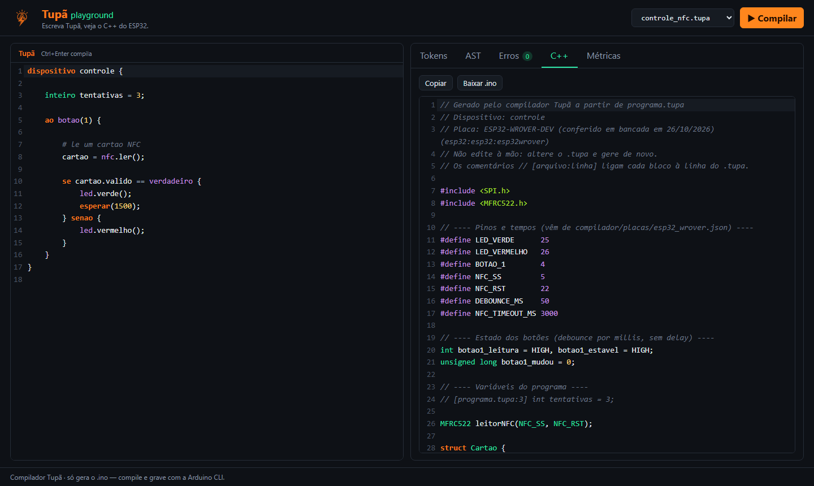
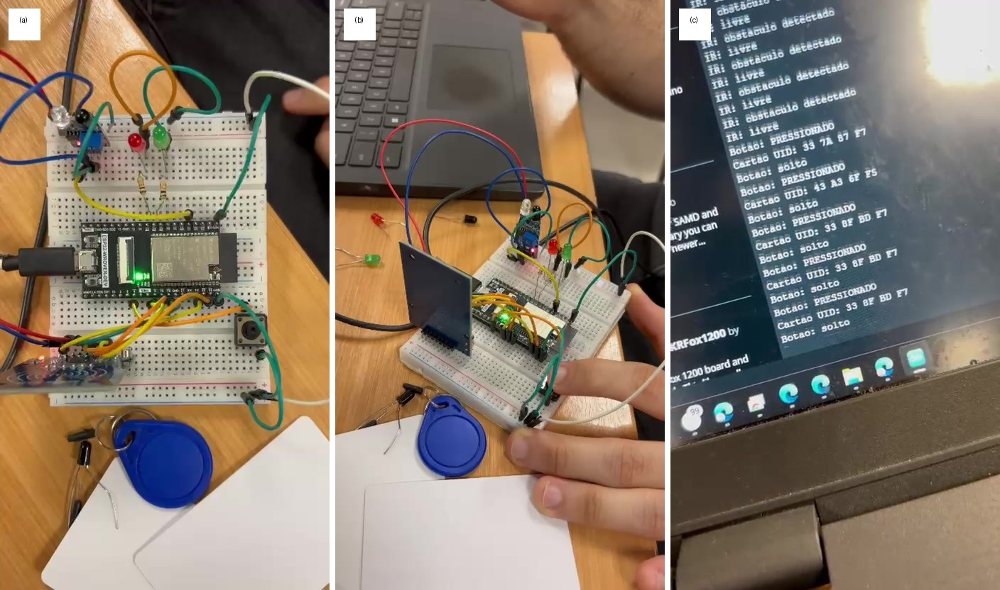
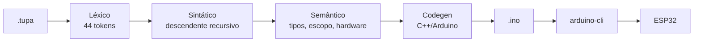

<div align="center">


# Tupã

**Da ideia ao hardware.**

**Playground online: https://tupa.mlutegar.com**

</div>



## O que é

Tupã é uma linguagem de domínio específico, em português, e o compilador que a traduz para C++/Arduino.
Você descreve o que o dispositivo ESP32 deve fazer (ao apertar um botão, ler um cartão NFC, acender um LED)
e o compilador gera o `.ino` pronto para gravar na placa.

**Por que existe:** programar microcontroladores exige C++, bibliotecas e documentação quase sempre em inglês.
Essa barreira afasta quem está começando. O Tupã troca isso por comandos legíveis em português, com erros
que explicam o que deu errado.



## Exemplo

À esquerda, o programa Tupã ([`examples/controle_nfc.tupa`](examples/controle_nfc.tupa)). À direita, um trecho do
C++ gerado ([`firmware/controle_nfc_gerado`](firmware/controle_nfc_gerado/controle_nfc_gerado.ino)).

<table>
<tr>
<th>Tupã</th>
<th>C++ gerado (trecho)</th>
</tr>
<tr>
<td valign="top">

```
dispositivo controle {

    inteiro tentativas = 3;

    ao botao(1) {

        # le um cartao NFC
        cartao = nfc.ler();

        se cartao.valido == verdadeiro {
            led.verde();
            esperar(1500);
        } senao {
            led.vermelho();
        }
    }
}
```

</td>
<td valign="top">

```cpp
// [controle_nfc.tupa:5] ao botao(1)
{
  int leitura = digitalRead(BOTAO_1);
  // ... debounce por millis() ...
  if (botao1_estavel == LOW) {
    Cartao cartao = nfcLer();
    if ((cartao.valido == true)) {
      ledVerde();
      delay(1500);
    } else {
      ledVermelho();
    }
    ledApagar();
  }
}
```

</td>
</tr>
</table>

Métricas reais, medidas na compilação:

| Programa | Linhas de código Tupã | Linhas de código C++ gerado | Razão |
|---|---:|---:|---:|
| `controle_nfc` | 12 | 100 | 8,3x |
| `teste_hardware` | 23 | 112 | 4,9x |

## Como funciona



- **Léxico:** 44 tipos de token (43 enviados ao parser mais `EOF`).
- **Sintático:** parser descendente recursivo, um token de lookahead, gramática em [`docs/linguagem.md`](docs/linguagem.md).
- **Semântico:** valida tipos, escopo, módulos e métodos, e a existência de pinos na placa.
- **Codegen:** gera o `.ino` com comentários `[arquivo:linha]` ligando cada bloco ao `.tupa`.
- **Gravação:** `arduino-cli` compila e grava; o compilador não depende dele para gerar o código.

## A linguagem

Eventos:

| Evento | Quando dispara |
|---|---|
| `ao iniciar` | uma vez, ao ligar a placa |
| `ao botao(N)` | uma vez por aperto do botão N (com debounce) |
| `ao obstaculo` | quando o sensor IR passa de livre para obstáculo |
| `ao cartao` | quando um cartão novo é lido (`cartao.uid`, `cartao.valido`) |

Módulos e comandos:

| Módulo | Métodos |
|---|---|
| `nfc` | `ler()` |
| `led` | `verde()`, `vermelho()`, `apagar()` |
| `ir` | `detectado()` |
| `botao` | `pressionado()` |
| comandos | `escrever(expr);`, `esperar(ms);` |

Os erros são didáticos. Trocando `led.verde()` por `led.roxo()`:

```
erro semantico - linha 3, coluna 12
    metodo inexistente no modulo 'led'
    disponiveis: verde(), vermelho(), apagar()
    led.roxo()

compilacao interrompida: 1 erro
```

Referência completa: [`docs/linguagem.md`](docs/linguagem.md) e [`docs/tabela-de-tokens.md`](docs/tabela-de-tokens.md).

## Hardware

- ESP32-WROVER-DEV
- Leitor NFC RC522
- Sensor IR de obstáculo
- Botão
- 2 LEDs (verde e vermelho)

Custo aproximado: **R$ 120**.

Pinagem (arquivo de placa [`compilador/placas/esp32_wrover.json`](compilador/placas/esp32_wrover.json)):

| Função | GPIO |
|---|---:|
| RC522 SS | 5 |
| RC522 RST | 22 |
| SPI SCK | 18 |
| SPI MISO | 19 |
| SPI MOSI | 23 |
| LED verde | 25 |
| LED vermelho | 26 |
| Sensor IR | 34 |
| Botão 1 | 4 |

Detalhes e ligações em [`firmware/pinagem.md`](firmware/pinagem.md).

## Começando

Requisitos: Python 3.9 ou superior.

```bash
pip install -e .

tupa build examples/controle_nfc.tupa -o firmware/controle_nfc_gerado   # gera o .ino
tupa tokens examples/controle_nfc.tupa                                  # lista os tokens
tupa ast examples/controle_nfc.tupa                                     # imprime a AST
```

Sem instalar, use `python -m compilador build|tokens|ast ...`.

Para compilar e gravar, instale o `arduino-cli`, o core ESP32 e a biblioteca MFRC522:

```bash
arduino-cli config init
arduino-cli config add board_manager.additional_urls https://espressif.github.io/arduino-esp32/package_esp32_index.json
arduino-cli core update-index
arduino-cli core install esp32:esp32
arduino-cli lib install MFRC522

arduino-cli board list
arduino-cli compile --fqbn esp32:esp32:esp32wrover firmware/controle_nfc_gerado
arduino-cli upload -p COMx --fqbn esp32:esp32:esp32wrover firmware/controle_nfc_gerado
```

## Playground local

```bash
docker compose up --build
```

Abra http://localhost:8000. O serviço escuta só em `127.0.0.1:8000`, roda sem root e tem healthcheck em `/api/saude`.

Sem Docker:

```bash
pip install -r requirements-web.txt
uvicorn web.api.main:app --reload
```

## Testes

```bash
python -m pytest tests -q
```

50 testes (compilador e API web).

## Estrutura de pastas

```
.
├── compilador/        # lexer, parser, semântico, codegen, CLI
│   └── placas/        # arquivos de placa (pinos, FQBN, UIDs)
├── examples/          # programas .tupa
├── firmware/          # .ino gerados e manuais, pinagem
├── web/
│   ├── api/           # FastAPI do playground
│   └── app/           # front React + CodeMirror
├── tests/             # pytest
├── docs/              # especificação, gramática, tokens, pitch
├── artigo/            # artigo IEEE (LaTeX e PDF) e figuras
├── Dockerfile
├── docker-compose.yml
├── deploy-git.ps1
├── REGISTRO.md        # diário de decisões
└── PROMPTS.md
```

## Artigo e apresentação

- Artigo: [`artigo/main.pdf`](artigo/main.pdf)
- Apresentação (pitch): [`docs/Tupa-Pitch.pdf`](docs/Tupa-Pitch.pdf)

## Autores

Michel Lutegar, André Costa, Felipe Dutrain e Guilherme Lopes.

Disciplina Linguagens Formais e Compiladores, IBMEC.

## Licença

[MIT](LICENSE).
